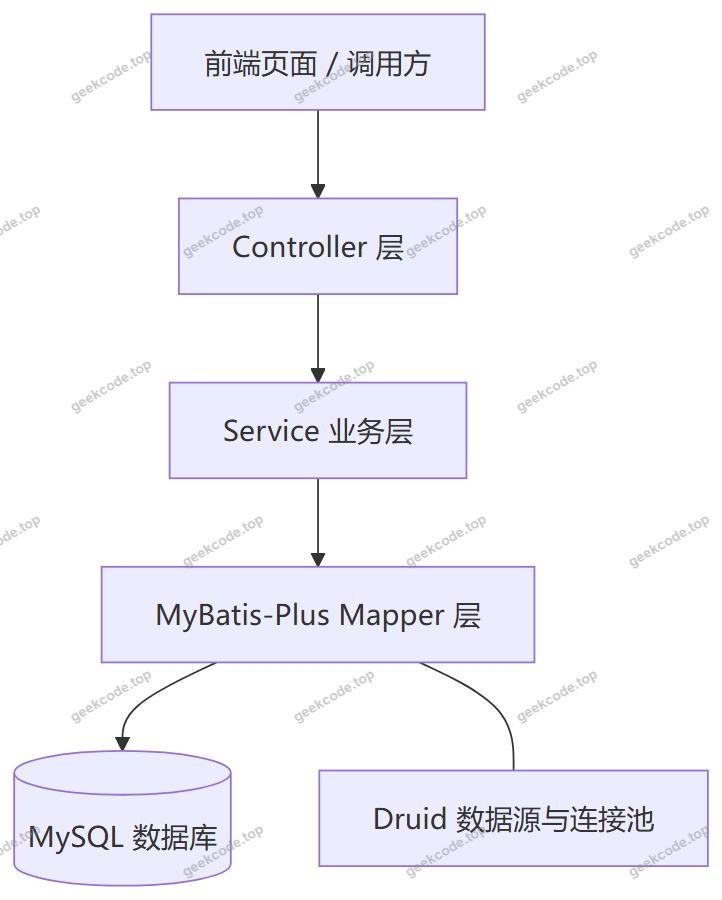
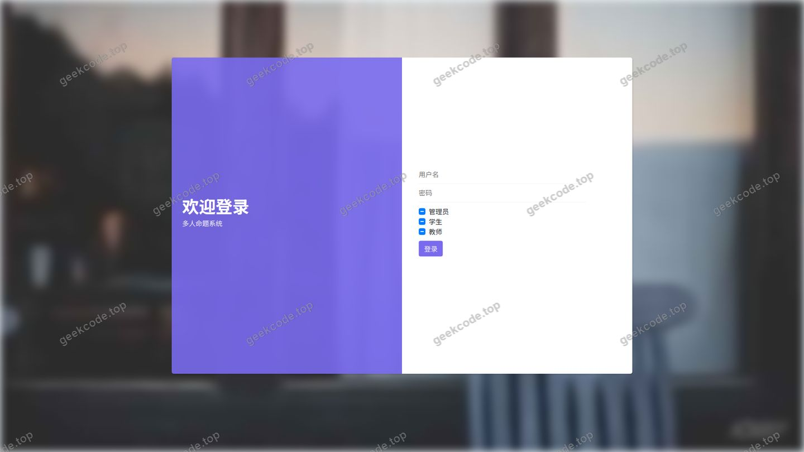
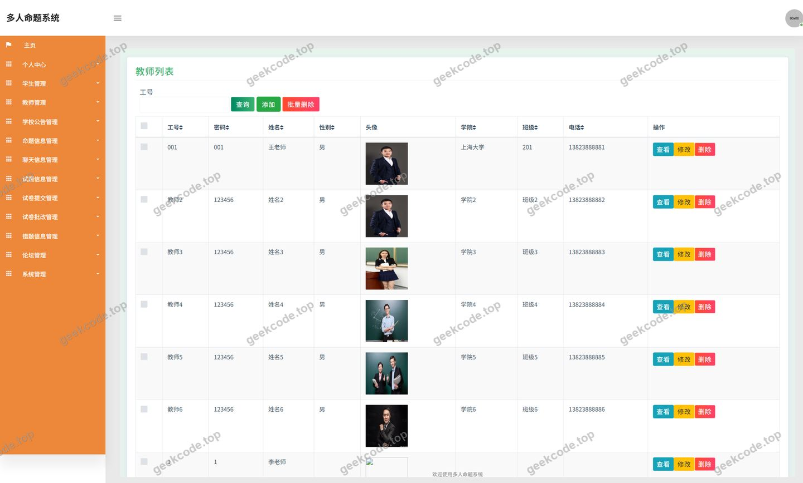
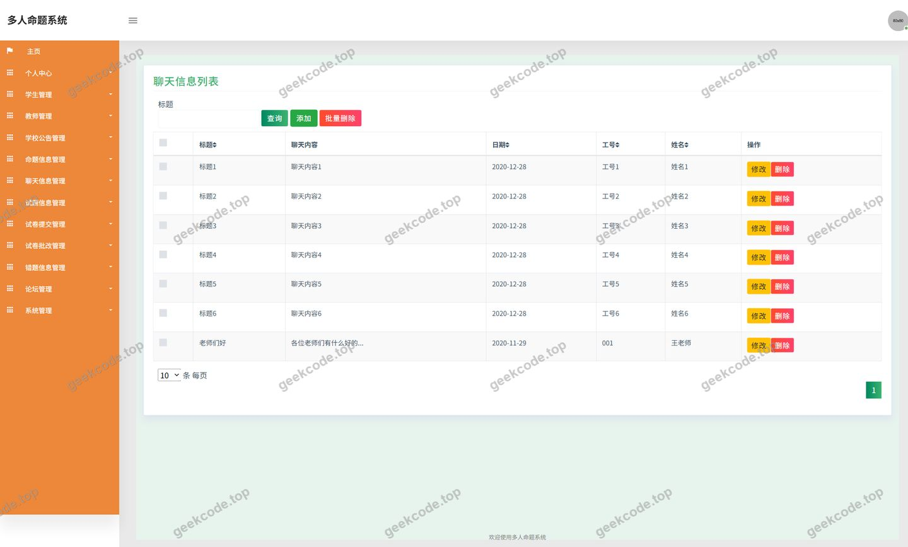
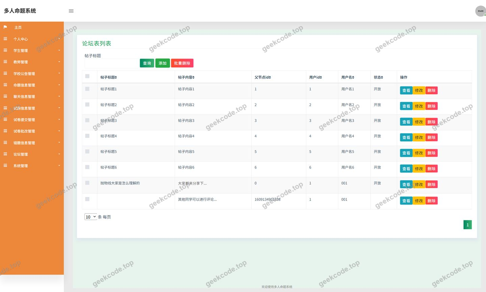
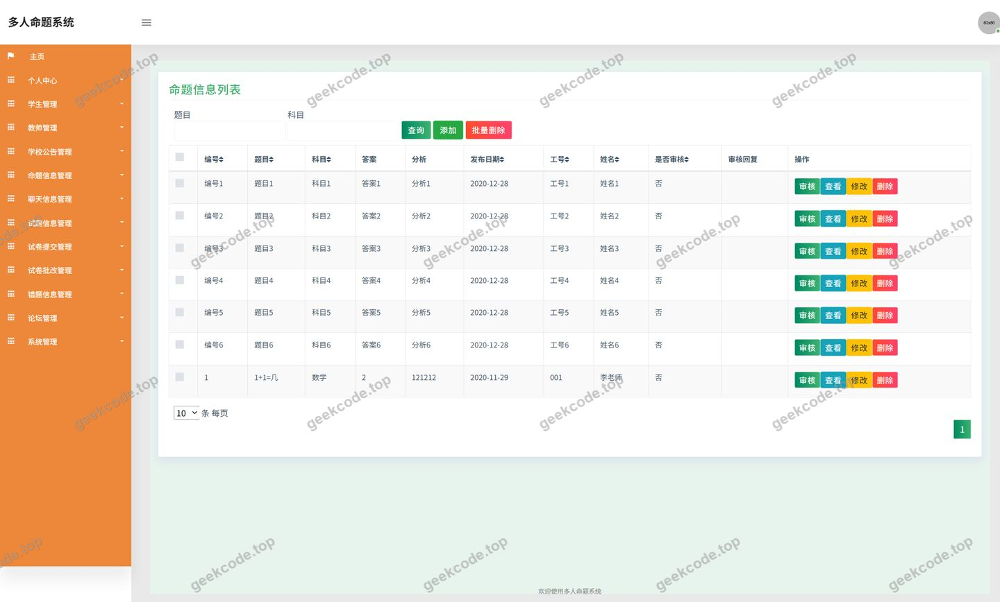
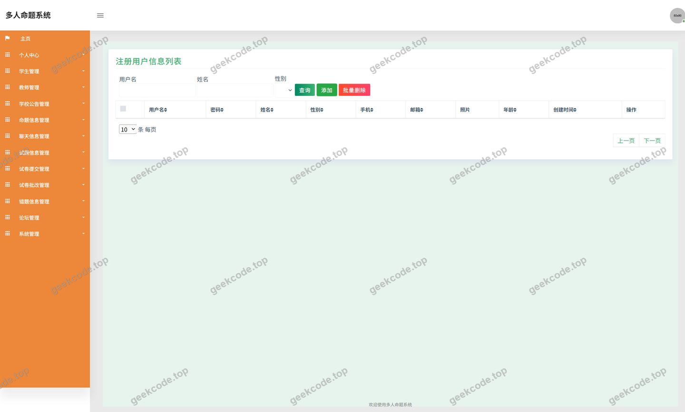
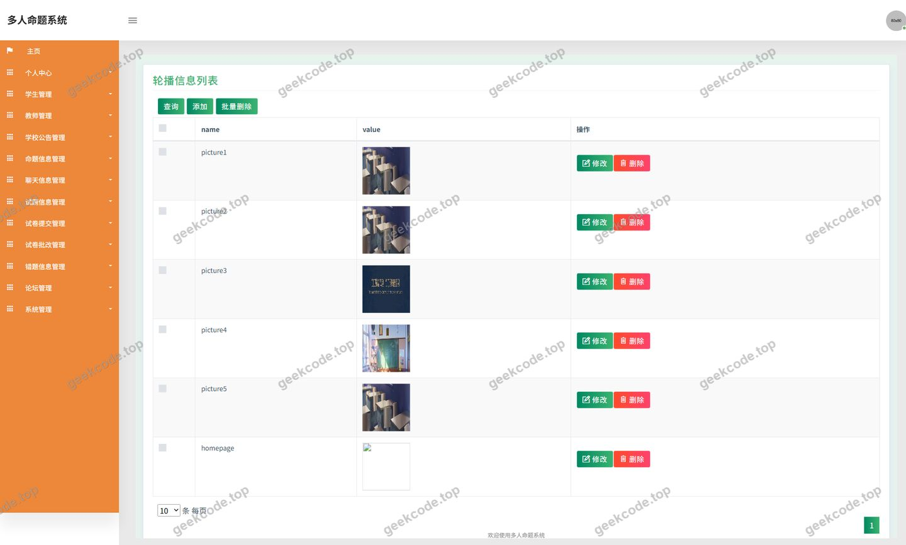
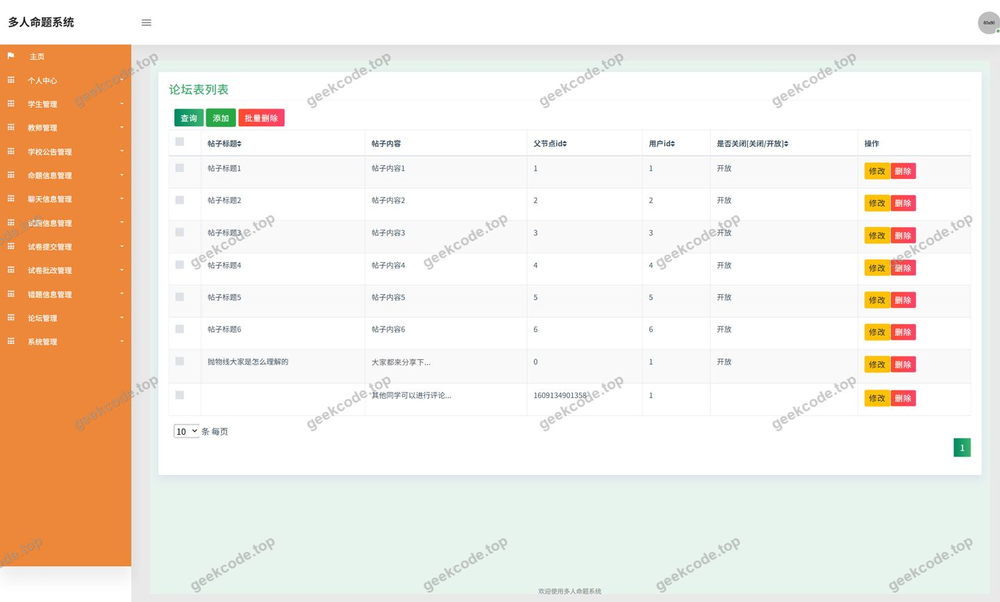

# ssm多人命题系统-java毕业设计

> 🎓 **计算机毕业设计 · ssm多人命题系统-java毕业设计**
>
> 本仓库只放**项目介绍 + 运行截图**（截图是站点带水印的原图，存在仓库 `images/` 里）。
>
> 👉 **完整可运行源码 / 数据库脚本 / 部署文档：[点我获取](https://geekcode.top/archives/ssm%E5%A4%9A%E4%BA%BA%E5%91%BD%E9%A2%98%E7%B3%BB%E7%BB%9F-java%E6%AF%95%E4%B8%9A%E8%AE%BE%E8%AE%A1?utm_source=github)**
>
> 💬 咨询微信：**ir9372**　|　🌐 更多项目：[极客代码 geekcode.top](https://geekcode.top/?utm_source=github)
>
> 📌 项目详情页：<https://geekcode.top/archives/ssm%E5%A4%9A%E4%BA%BA%E5%91%BD%E9%A2%98%E7%B3%BB%E7%BB%9F-java%E6%AF%95%E4%B8%9A%E8%AE%BE%E8%AE%A1?utm_source=github>

<table><td width="230" align="center"> <b>扫码加微信 ir9372</b></td><td valign="middle">📦 源码 = 项目介绍 + 全部运行截图 + 数据库 + 部署文档 👉 点上方任意截图，直接跳到 <b>极客代码 geekcode.top</b> 详情页</td></table>

---

<h1>ssm多人命题系统-java毕业设计</h1>
<h2>项目概述</h2>

多人命题系统是一套面向学校教学场景的试题命题与考试管理后端服务，采用纯 API 形式对外提供接口，本身不包含渲染页面。系统围绕&quot;教师命题—学生答题—试卷提交—批改—错题沉淀&quot;的完整闭环展开，同时提供学校公告、试题信息、论坛信息、聊天信息等辅助功能模块。系统名称中的&quot;多人命题&quot;体现由多位教师共同参与试题与命题信息创建与维护的协作特征。

核心业务能力由后端控制器承载：命题信息（MingtixinxiController）、试题信息（ShitixinxiController）、试卷提交（ShijuantijiaoController）、试卷批改（ShijuanpigaiController）、错题信息（CuotixinxiController）、论坛（ForumController）、聊天信息（LiaotianxinxiController）、教师（JiaoshiController）、用户（UserController）以及公告与通用接口（CommonController）、配置（ConfigController）、文件（FileController）。

适用人群为学校教务管理人员、任课教师与学生。技术架构为 Spring + Spring MVC + MyBatis-Plus + Druid 的经典分层服务端架构。

<h2>技术架构</h2>
<h3>整体架构</h3>

项目为纯 API 后端工程，未包含前台路由与后台路由定义，也未包含页面渲染模板，接口通过 HTTP 对外提供服务。

<h3>分层职责</h3>
<ul>
<li><strong>Controller 层</strong>：由 CommonController、ConfigController、CuotixinxiController、FileController、ForumController、JiaoshiController、LiaotianxinxiController、MingtixinxiController、ShijuanpigaiController、ShijuantijiaoController、ShitixinxiController、UserController 共 12 个控制器组成，分别对应公告与通用操作、系统配置、错题信息、文件上传、论坛、教师、聊天信息、命题信息、试卷批改、试卷提交、试题信息、用户等业务域。</li>
<li><strong>业务层与服务支撑</strong>：由 spring-context、spring-context-support 提供容器与上下文支撑能力。</li>
<li><strong>事务与切面</strong>：spring-tx 负责事务管理，spring-aop 提供面向切面能力。</li>
<li><strong>数据访问层</strong>：MyBatis-Plus 作为持久层框架，配合 spring-jdbc 完成数据库交互。</li>
<li><strong>Web 层</strong>：spring-web 与 spring-webmvc 提供 Web MVC 能力。</li>
<li><strong>数据源</strong>：Druid 作为数据库连接池。</li>
<li><strong>测试</strong>：junit 提供单元测试支持。</li>
</ul>
<h3>核心技术选型理由</h3>
<table>
<thead>
<tr>
<th>技术</th>
<th>选型理由</th>
</tr>
</thead>
<tbody><tr>
<td>Spring / Spring MVC</td>
<td>提供 IoC 容器与 Web MVC 能力，事务、切面、上下文模块可独立组合，便于分层管理与解耦</td>
</tr>
<tr>
<td>MyBatis-Plus</td>
<td>在 MyBatis 基础上提供通用 CRUD 能力，减少试题、命题、试卷、错题等实体表的重复 SQL 编写</td>
</tr>
<tr>
<td>Druid</td>
<td>提供数据库连接池能力，便于连接复用与数据源管理</td>
</tr>
<tr>
<td>spring-tx / spring-aop</td>
<td>保障试卷提交、批改等涉及多表写入操作的原子性，并通过切面统一处理横切逻辑</td>
</tr>
<tr>
<td>junit</td>
<td>对业务逻辑进行单元测试</td>
</tr>
</tbody></table>
<h3>数据库设计要点</h3>
<ul>
<li>数据库实体围绕用户、教师、试题信息、命题信息、试卷提交、试卷批改、错题信息、论坛、聊天信息、公告、轮播图等业务对象组织，与控制器划分基本一一对应。</li>
<li>数据访问统一通过 MyBatis-Plus 的 Mapper 完成，由 Druid 数据源提供连接。</li>
<li>具体表结构、字段定义与索引策略在现有源码与配置中未提供，根据现有信息无法确定。</li>
</ul>
<h2>功能模块</h2>
<h3>前台用户端</h3>
<ul>
<li><strong>登录</strong>：系统入口功能，对应截图&quot;页面-登录&quot;，用于身份识别与角色区分。</li>
<li><strong>个人中心</strong>：个人中心菜单项，用于查看与维护个人资料。</li>
<li><strong>我的发布</strong>：个人中心菜单项，用于管理当前用户发布的内容。</li>
<li><strong>学校公告</strong>：前台导航菜单项，由 CommonController 相关的公告能力支撑，用于展示学校通知与公告内容。</li>
<li><strong>试题信息</strong>：前台导航菜单项，对应 ShitixinxiController，用于浏览与查询试题内容。</li>
<li><strong>论坛信息</strong>：前台导航菜单项，对应 ForumController，对应截图&quot;页面-论坛&quot;，用于话题发布与交流。</li>
<li><strong>命题信息</strong>：对应 MingtixinxiController，对应截图&quot;页面-命题信息&quot;，用于命题任务的发布与查看，是&quot;多人命题&quot;的核心业务承载。</li>
<li><strong>试卷提交</strong>：对应 ShijuantijiaoController，用于学生提交作答结果。</li>
<li><strong>试卷批改</strong>：对应 ShijuanpigaiController，用于教师对提交的试卷进行批改。</li>
<li><strong>错题信息</strong>：对应 CuotixinxiController，用于记录与查看错题内容。</li>
<li><strong>聊天信息</strong>：对应 LiaotianxinxiController，对应截图&quot;页面-聊天信息&quot;，用于用户之间的消息沟通。</li>
<li><strong>教师信息</strong>：对应 JiaoshiController，对应截图&quot;页面-教师&quot;，用于教师信息的展示与维护。</li>
<li><strong>学生信息</strong>：对应截图&quot;页面-学生&quot;，用于学生相关信息的展示与维护。</li>
<li><strong>普通用户</strong>：对应截图&quot;页面-defaultuser&quot;，作为默认用户角色的页面入口。</li>
<li><strong>文件服务</strong>：对应 FileController，提供文件上传等能力。</li>
</ul>
<h3>后台管理端</h3>
<ul>
<li><strong>轮播图管理</strong>：对应截图&quot;lunbotuguanli&quot;，用于首页轮播图的维护。</li>
<li><strong>论坛管理</strong>：对应截图&quot;luntanguanli&quot;，用于论坛帖子与话题的管理。</li>
<li><strong>用户与教师管理</strong>：由 UserController、JiaoshiController 支撑，用于账号与教师信息维护。</li>
<li><strong>系统配置管理</strong>：由 ConfigController 支撑，用于系统级参数配置。</li>
<li><strong>公告与通用管理</strong>：由 CommonController 支撑，用于公告及公共数据维护。</li>
</ul>

后台路由在项目配置中未定义，管理页面以截图所示功能为准。

<h2>用户角色与权限</h2>

系统角色依据控制器划分与截图页面划分为管理员、教师、学生、普通用户四类。

<h3>管理员</h3>
<ul>
<li>系统配置管理（ConfigController）</li>
<li>用户管理（UserController）</li>
<li>教师管理（JiaoshiController）</li>
<li>轮播图管理（lunbotuguanli 页面）</li>
<li>论坛管理（luntanguanli 页面）</li>
<li>公告与通用数据管理（CommonController）</li>
<li>文件资源管理（FileController）</li>
</ul>
<h3>教师</h3>
<ul>
<li>命题信息维护与发布（MingtixinxiController）</li>
<li>试题信息维护（ShitixinxiController）</li>
<li>试卷批改（ShijuanpigaiController）</li>
<li>错题信息查看（CuotixinxiController）</li>
<li>学生信息查看（学生页面）</li>
<li>论坛信息浏览与发布（ForumController）</li>
<li>聊天信息沟通（LiaotianxinxiController）</li>
<li>个人中心与我的发布</li>
</ul>
<h3>学生</h3>
<ul>
<li>试题信息浏览（ShitixinxiController）</li>
<li>命题信息查看（MingtixinxiController）</li>
<li>试卷提交（ShijuantijiaoController）</li>
<li>错题信息查看（CuotixinxiController）</li>
<li>论坛信息浏览与发布（ForumController）</li>
<li>聊天信息沟通（LiaotianxinxiController）</li>
<li>学校公告浏览</li>
<li>个人中心与我的发布</li>
</ul>
<h3>普通用户</h3>
<ul>
<li>登录后进入默认用户页面（defaultuser 页面）</li>
<li>学校公告浏览</li>
<li>试题信息浏览</li>
<li>论坛信息浏览与发布</li>
<li>个人中心与我的发布</li>
<li>文件上传（FileController）</li>
</ul>

各角色具体可访问的接口清单与按钮级权限，在现有源码与配置中未提供，根据现有信息无法确定。

<h2>项目特色与创新点</h2>
<ul>
<li><strong>多人协作命题</strong>：系统以命题信息为核心业务对象（MingtixinxiController），支持多名教师共同参与试题与命题信息的创建与维护，区别于单人命题的单一流程设计。</li>
<li><strong>完整的考试业务闭环</strong>：命题信息、试题信息、试卷提交、试卷批改、错题信息五个模块串联形成&quot;出题—答题—提交—批改—错题沉淀&quot;的完整链路。</li>
<li><strong>错题信息的独立沉淀</strong>：通过 CuotixinxiController 单独承载错题数据，使错题记录从批改环节中解耦，便于后续查看与复用。</li>
<li><strong>沟通渠道双通道设计</strong>：论坛（ForumController）用于公开话题交流，聊天信息（LiaotianxinxiController）用于即时消息沟通，覆盖公开与点对点两类交流场景。</li>
<li><strong>服务端能力集中化</strong>：通过 CommonController、ConfigController、FileController 将公告、配置、文件等横切能力集中封装，各业务控制器专注业务本身。</li>
<li><strong>分层清晰、便于扩展</strong>：12 个控制器按业务域严格划分，配合 MyBatis-Plus 通用 CRUD 能力，新增业务模块的边际成本较低。</li>
</ul>
<h2>部署环境</h2>
<h3>运行环境</h3>
<ul>
<li><strong>JDK</strong>：项目依赖 spring-core、spring-context、spring-aop 等 Spring 生态组件，需安装 Java 运行环境并配置 JAVA_HOME。</li>
<li><strong>MySQL</strong>：作为关系型数据库，业务数据通过 MyBatis-Plus 与 Druid 数据源访问，需部署 MySQL 实例并导入数据库脚本。</li>
<li><strong>构建工具</strong>：项目以 Maven 依赖坐标形式管理 junit、spring-* 系列、MyBatis-Plus、Druid 等依赖，需使用 Maven 完成依赖拉取与构建。</li>
</ul>
<h3>无需安装的组件</h3>
<ul>
<li>项目类型为 pure-api，不包含前台与后台页面路由，未提供 Node.js 相关依赖与前端构建配置，因此无需安装 Node.js 与前端构建工具。</li>
<li>项目未提及微信开发者工具相关依赖，因此无需安装。</li>
</ul>
<h3>部署要点</h3>
<ul>
<li>配置 Druid 数据源的数据库连接地址、账号与密码。</li>
<li>启动后以 HTTP 接口形式对外提供服务，前端页面或调用方通过接口访问各业务模块。</li>
<li>具体服务端口、上下文路径、数据库脚本与配置文件内容在现有源码与配置中未提供，根据现有信息无法确定。</li>
</ul>
<h2>五、技术特性</h2>
<ul>
<li>使用 MyBatis-Plus 简化数据访问层开发</li>
</ul>
<h2>六、功能模块截图</h2>
<h3>后台管理端</h3>
<h4>页面-登录</h4>

<h4>页面-教师</h4>

<h4>页面-聊天信息</h4>

<h4>页面-论坛</h4>

<h4>页面-命题信息</h4>

<h4>页面-学生</h4>

<h4>页面-defaultuser</h4>

<h4>页面-lunbotuguanli</h4>

<h4>页面-luntanguanli</h4>

---

## 获取完整源码

| 项目 | 说明 |
| --- | --- |
| 项目名 | ssm多人命题系统-java毕业设计 |
| 运行截图 | 本文 10 张（站点带水印原图，仓库 `images/` 目录） |
| 完整源码 | [https://geekcode.top/archives/ssm%E5%A4%9A%E4%BA%BA%E5%91%BD%E9%A2%98%E7%B3%BB%E7%BB%9F-java%E6%AF%95%E4%B8%9A%E8%AE%BE%E8%AE%A1?utm_source=github](https://geekcode.top/archives/ssm%E5%A4%9A%E4%BA%BA%E5%91%BD%E9%A2%98%E7%B3%BB%E7%BB%9F-java%E6%AF%95%E4%B8%9A%E8%AE%BE%E8%AE%A1?utm_source=github) |
| 咨询微信 | **ir9372**（备注：jingpin-yuanma） |
| 更多项目 | [极客代码 geekcode.top](https://geekcode.top/?utm_source=github) |

> 需要源码、部署、改配置、跑不起来等问题，加微信 ir9372 沟通，说明项目名即可。
